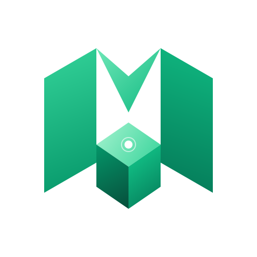

<div align="center">
  

  <p align="center">
    <strong>Centralized Cloud Deployment &amp; Multi-Server Mesh Management Platform</strong>
  </p>

  <p align="center">
    <a href="https://github.com/softtyos/meshdock/stargazers"></a>
    <a href="https://github.com/softtyos/meshdock/network/members"></a>
    <a href="https://github.com/softtyos/meshdock/blob/dev/LICENSE"></a>
    <a href="https://www.softty.net"></a>
  </p>
</div>

---

## 🌐 About Meshdock

**Meshdock** is an open-source, centralized Platform as a Service (PaaS) and Multi-Server Mesh Management platform developed by **SOFTTY.NET**. It unifies deployment automation, multi-node infrastructure management, real-time telemetry, and visual topology into a single pane of glass.

Whether you run a fleet of independent VPS nodes, bare-metal servers, or Docker Swarm clusters, Meshdock connects them into an observable, resilient deployment mesh.

---

## ✨ Key Capabilities

- **🚀 Universal Application Deployments**:
  Deploy web applications, microservices, and APIs in any language (Node.js, Go, Python, PHP, Rust, Ruby, Dockerfile, Nixpacks, Buildpacks, and Docker Compose) with zero-downtime updates.
- **🖥️ Centralized Multi-Node Control Plane**:
  Manage all your distributed servers, VPS nodes, and remote clusters from one unified interface without constant context switching or repetitive manual SSH operations.
- **🗄️ Managed Databases & Automated Backups**:
  One-click provisioning for PostgreSQL, MySQL, MariaDB, MongoDB, Redis, and LibSQL with scheduled backups to S3-compatible object storages (AWS S3, Cloudflare R2, MinIO, etc.).
- **🔀 Traefik Routing & Automated SSL**:
  Native Traefik integration provides automatic SSL/TLS certificate management (Let's Encrypt), intelligent path routing, and load balancing out of the box.
- **📊 Real-time Monitoring & Vector Telemetry**:
  Streamlined metrics and logs for CPU, memory, disk I/O, network usage, and container health with support for Prometheus, Grafana Loki, Datadog, and Vector agents.
- **🔔 Proactive Alerts & Notifications**:
  Instant notifications for build events, deployment failures, high resource thresholds, and server restarts via Telegram, Discord, Slack, and Email.
- **🛡️ Enterprise Security & Forward Auth**:
  Built-in role-based access control (RBAC), SSO authentication gates (OIDC/SAML), audit logging, and custom whitelabeling.

---

## 🚀 Quick Start

### Self-Hosted Installation

To set up Meshdock on a clean Ubuntu/Debian server or VPS (requires Docker installed):

```bash
# Clone the repository
git clone https://github.com/softtyos/meshdock.git
cd meshdock

# Setup environment & dependencies
pnpm install
cp apps/dokploy/.env.example apps/dokploy/.env

# Start Meshdock local development
pnpm run dokploy:setup
pnpm run dokploy:dev
```

Open your browser at `http://localhost:3000` to configure the owner account and onboard your first node.

---

## 🛠️ Tech Stack

- **Frontend**: Next.js 14, React, Tailwind CSS, Radix UI, Lucide Icons, Shadcn UI
- **Backend**: Node.js, tRPC, Drizzle ORM, Dockerode, WebSockets
- **Infrastructure**: Docker, Docker Swarm, Traefik v3, Vector, cAdvisor
- **Languages**: TypeScript, Go, Shell

---

## 🤝 Contributing

Contributions, bug reports, and feature proposals are welcome! Please read our [Contributing Guide](CONTRIBUTING.md) to get started with development, code conventions, and pull request guidelines.

---

## 📜 License & Acknowledgements

- Meshdock is distributed under the **Apache License 2.0**.
- Meshdock builds upon foundational open-source architecture pioneered by the Dokploy project and community contributors under the Apache 2.0 license.

Developed with ❤️ by **[SOFTTY.NET](https://www.softty.net)**.
